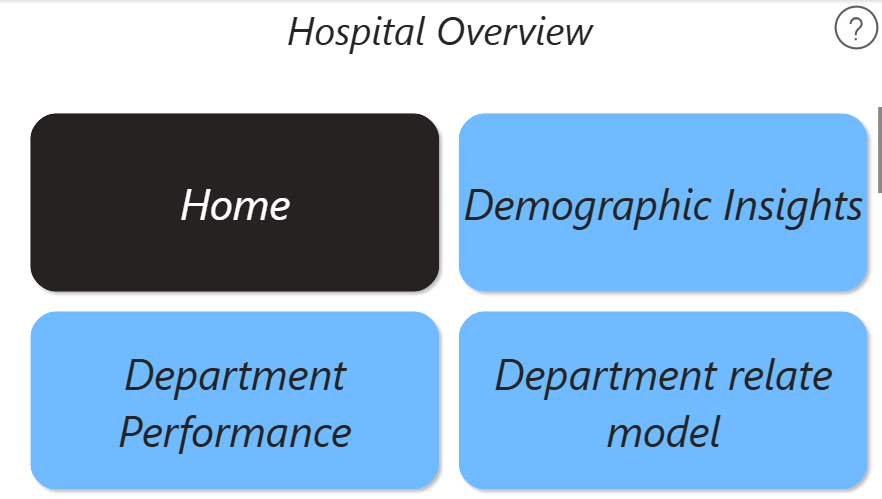
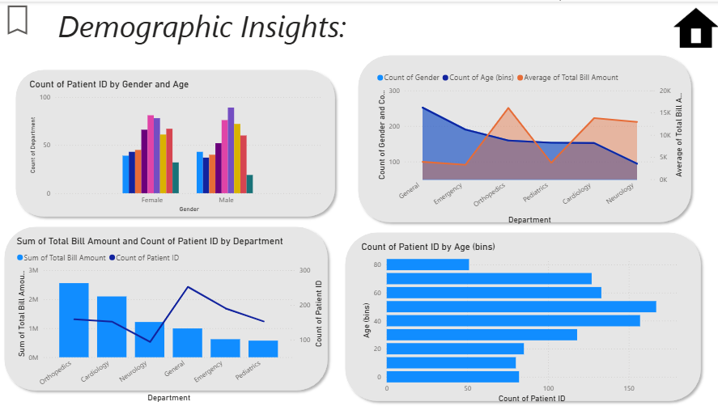
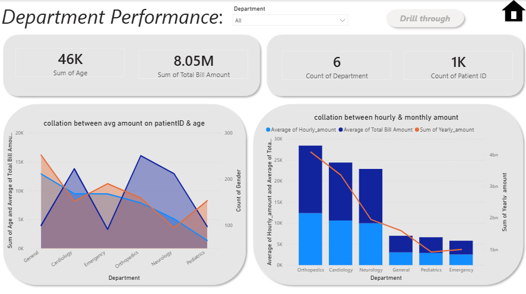
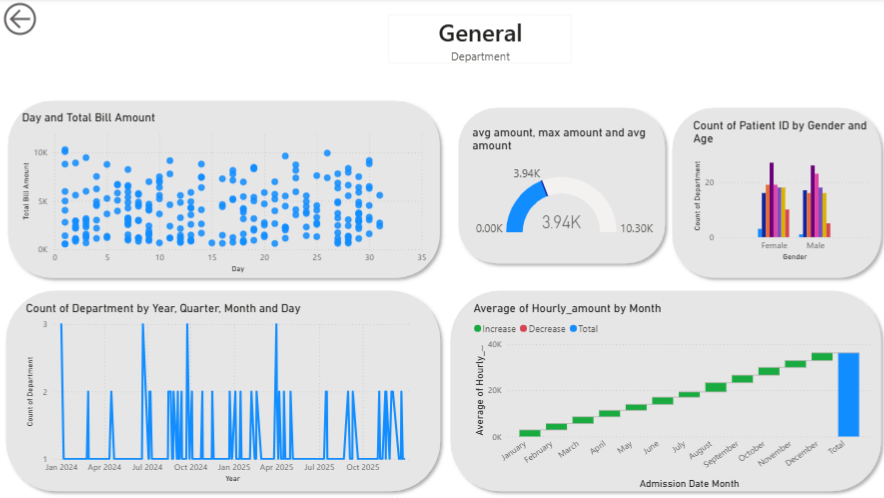

# 🏥 Hospital Performance & Clinical Data Analytics Dashboard

An enterprise-grade, end-to-end **Power BI Dashboard** developed to clean, model, and visualize dynamic healthcare datasets. This project transforms raw medical records into high-impact executive insights, employing advanced interactive patterns such as customized cross-page navigation, dynamic drill-throughs, and time-series drill-downs.

---

## 🧭 Project Architecture & Interactive Flow

The interface is intentionally partitioned into strategic analytical layers to ensure maximum clarity for hospital administrators and data stakeholders:

### 1. Unified Control Center (`Main Menu`)
* **Purpose:** Acts as a clean, user-facing navigation cockpit. It abstracts behind-the-scenes data engineering steps (Power Query transformations) and exposes only high-value visualization categories to the executive end-user via interactive button mappings.
* **Visual Baseline:**
  

### 2. Deep-Dive Patient Analysis (`Demographic Insights`)
* **Purpose:** Breaks down core operational volume (`Count of Patient ID`) directly against demographic boundaries including categorical age bins and gender distributions. This layer highlights how patient profiles vary across multiple medical wards.
* **Visual Baseline:**
  

### 3. Financial & Operational KPIs (`Department Performance`)
* **Purpose:** Monitors top-line metrics with static high-level metric cards detailing total institutional throughput (Total Billing: **\$8.05M**, Patient Volume: **1K**). 
* **Advanced Feature:** Implements a context-aware **Drill-Through** action. Users can right-click any specific department block to dynamically push relevant filter contexts straight into the granular analytics view.
* **Visual Baseline:**
  

### 4. Advanced Time-Series Drill-Down (`General` Ward Detail View)
* **Purpose:** Houses granular statistical mappings, utilizing waterfall charts to map progressive monthly admission shifts and automated gauges showing capacity averages (`3.94K`).
* **Advanced Feature:** Features full hierarchical **Drill-Down** navigation on dates, letting stakeholders instantly shift perspectives from macroscopic annual trends down to specific quarterly, monthly, and daily billings.
* **Visual Baseline:**
  

---

## 🛠️ Data Engineering & ETL Pipeline (Power Query)

Before staging the visuals, the underlying schema underwent rigorous transformation to ensure complete data integrity:
* **Relational Schema Design:** Structured a functional analytical model (`Data Modeling`), implementing explicit relationships to support frictionless cross-filtering across tables.
* **Granular Aggregations (`Group By`):** Pre-compiled critical metrics like average hourly expenditure and total monthly volume to optimize engine speed.
* **Data Integration (`Merge` & `Append`):** Unified distinct tabular datasets into a singular, clean transactional architecture, fixing missing keys and aligning date-time constraints.

---

## ⚡ Technical Summary
* **Bi-Directional Filtering:** Configured custom interactive behaviors between scatter and bar charts.
* **DAX & M-Language Framework:** Utilized optimized logical chains for calculating averages without straining dashboard memory.
* **User-Centric UX:** Fully hidden backend pages (`Hide Page`) to secure technical structures from non-technical stakeholders.
